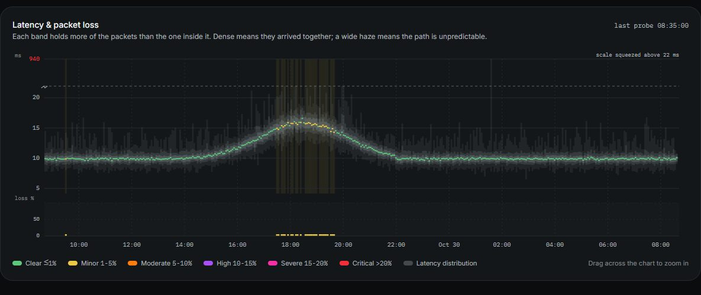

# ClearPing Automatic Probe Scheduler

## Overview

ClearPing includes an automatic probe scheduler that works similarly to **Smokeping**. The scheduler automatically probes all active monitors at their configured intervals, capturing measurements and storing them for visualization on the graphs.

## How It Works

### Automatic Probing

- When you create a monitor, you specify a **probe interval** (in seconds)
- The scheduler checks every second for monitors that need to be probed
- When a monitor's interval has elapsed, the scheduler automatically:
  1. Executes a probe (ICMP ping, ARP, TCP, game query, HTTP or DNS)
  2. Captures the latency and packet loss
  3. Stores the measurement in the database
  4. Updates the last probe timestamp

### Example

If you set a monitor to probe every **300 seconds (5 minutes)**:
- The monitor will be probed automatically every 5 minutes
- Each probe sends 20 ICMP packets (configurable)
- The results are averaged and stored
- The graphs automatically update with new data

## Configuration

### Monitor Intervals

When creating or editing a monitor, you can set the probe interval:

```typescript
{
  name: "Google DNS",
  host: "8.8.8.8",
  probeType: "ping",
  interval: 300,  // Probe every 5 minutes (300 seconds)
  status: "active"
}
```

Common intervals:
- `60` - Every 1 minute (frequent monitoring)
- `300` - Every 5 minutes (default, like Smokeping)
- `600` - Every 10 minutes
- `3600` - Every 1 hour

### Ping Configuration

By default, each probe sends **20 pings** with a **1 second timeout**. On Linux, which
is what the Docker image and the probe agent run, one `ping` sends them all, **50 ms**
apart, so a reading takes about a second. Where `ping` will not send that fast without
root, and on Windows and macOS, each goes out on its own **10 ms** after the answer to
the one before. The defaults live in [src/lib/probes/ping.ts](../src/lib/probes/ping.ts).

## What Each Kind of Monitor Measures

The sidebar labels every monitor `IP`, `DOMAIN`, `ARP`, `TCP`, `GAME`, `HTTP` or `DNS`. The label is
derived from the address and the probe method, and each kind is measured differently:

| Monitor | Example | What a probe does |
|--------|---------|-------------------|
| **IP** | `1.1.1.1`, `2606:4700:4700::1111` | Pings the address directly with ICMP echo requests. |
| **Domain** | `example.com` | Resolves the name once, then sends every packet of that probe to the one address it returned. |
| **ARP** | `192.168.1.20` with the ARP method | Asks who has the address over ARP and times the reply. 20 requests per probe, as ping. Same network, IPv4 and Linux only. |
| **TCP** | `db.internal:5432` | Opens a connection to the port, times the handshake and closes it. 10 attempts per probe. |
| **Game** | `udp://203.0.113.5:27015` | Asks the server how it is, in its game's own query, and times the answer. 10 queries per probe. |
| **HTTP** | `https://example.com/health` | Makes the request and checks the answer. 3 requests per probe, each on a fresh connection. |
| **DNS** (server) | `8.8.8.8` with the DNS method | Sends DNS queries straight to that server and times the answers. No ping. |
| **DNS** (name) | `example.com` with the DNS method | Looks the name up and times the answer: through the system resolver, or through each of the resolvers you list for it. No ping. |

The address box accepts a URL, `host:port` or `udp://host:port` and picks the method to match. Whatever
the method, the host is resolved once per probe and the resolved address is shown
next to the monitor, so the IPv4/IPv6 setting below applies to all of them.

### ARP

For devices on your own network that drop or rate-limit ping: phones, printers,
IoT devices, hosts with a firewall on. Nothing on a network can talk without
answering ARP, so a reply says the device is really there, and its time says how
the local link to it is doing. "Loss" is the share of ARP requests that got no
reply, read in steps of one request as ping's packets are, and the count is set
the same way (5 to 100, 20 unless said).

- **Same network only.** ARP does not cross a router. The probe first finds which
  of the measuring machine's own networks holds the address, and fails with
  *Not on a local network of this machine* when none does, rather than reading
  100% loss. For most set-ups that machine is a [probe agent](probe-agents.md) on
  the LAN, not the dashboard.
- **In Docker,** a container on Docker's default network can only see Docker's
  bridge. Give it the host's network (`network_mode: host`) to probe the LAN.
- **IPv4 only.** IPv6 has Neighbor Discovery instead. A name is resolved to its
  IPv4 address, and the IP version cannot be set to IPv6 or both.
- **Linux only,** through `arping` from iputils, which the Docker images include.
  It needs `CAP_NET_RAW`, as ping does; Debian's package grants the program that
  itself, so it runs as the containers' non-root user.

Each request is a run of `arping` of its own, one after another, because
`arping` spaces the requests of one run a whole second apart. Twenty answered
requests take about as long as ping's twenty packets; each one that goes
unanswered costs its one-second timeout, as a lost ping does.

### TCP

For hosts that drop ICMP, and for knowing a service is listening rather than merely
that the machine is up. "Loss" is the share of connection attempts that failed. The
error distinguishes a refused connection (nothing listening) from a timeout
(something dropping the packets).

### Game servers

A game server says nothing to a packet it does not understand, so a game server
probe asks in the game's own query and times the answer. "Loss" is the share of
queries that got no answer. Pick the game the server runs:

| Game | Over | Answered by | Usual port |
|------|------|-------------|------------|
| **Steam (A2S)** | UDP | Counter-Strike 2, Rust, ARK, Garry's Mod, Valheim, DayZ, TF2 and most Steam game servers | 27015 |
| **Minecraft Java** | TCP | Java servers and proxies such as BungeeCord and Velocity | 25565 |
| **Minecraft Bedrock** | UDP | Bedrock and Education servers, Geyser | 19132 |
| **Quake 3 / FiveM** | UDP | FiveM, RedM, Quake 3, Enemy Territory, older Call of Duty | 30120, 27960 |
| **Any other game** | UDP | Call of Duty, Valorant, League of Legends, Fortnite: games that answer no query (below) | the game port |

Minecraft Java's is the game's own server list ping: each query connects, reads
the server's status and times a ping, which is the figure the game's multiplayer
screen shows. The name that is sent with it is the monitor's, so a proxy that
picks a server by name picks the right one.

For a Steam game, use the server's **query port**. For many games it is the game port, but not for
all: Rust's is set by `server.queryport`, Valheim's is the game port plus one, and
ARK's is 27015 by default.

**Games that answer no query.** Current Call of Duty, Valorant, League of
Legends, Fortnite and most other big online games run their own servers with
their own encrypted protocols. A server like that only talks to players who have
joined its match, and drops anything else sent to its game port, so a query gets
nothing back. Many of them block ping as well.

**Any other game** sends UDP packets to ports on the server that nothing
listens on (33434 and up, as traceroute does), and times the server's own
"port unreachable" answer, which many servers that
block ping still send. The reading is the server and the way to it: up or not,
how fast, and how many packets went missing. It cannot say whether the game on
the server is running, which only someone in the match can see.

- **Needs Linux.** Linux passes the "port unreachable" on to ClearPing; Windows
  does not, and the check says so there instead of showing loss. The Docker
  image is Linux, and so is a probe agent on a Raspberry Pi.
- **A second apart.** Servers answer only about one "port unreachable" a second
  after a short burst, so the 10 queries of a probe are spaced a second apart,
  or the server's own limit would show as loss.
- **Not every server answers.** One whose firewall drops everything, closed ports
  included, as Google Cloud's does, can't be measured this way. Until it has
  answered once, its monitor is grey with "Can't measure" rather than offline,
  its page says why, and it raises no alerts. Once it has answered, silence is
  an outage again. Check first: `mtr --udp <address>`
  gets the same reply, so it shows the server's address as its last hop when
  this will work, and `???` there when it won't. To watch the way to a server
  like that, add the last hop that does answer as a ping monitor: it is usually
  where your traffic enters the host's network.

To watch the network to one of them:

- **Trace the route when it loses packets.** An alert on packet loss, set to
  trace, records the route at the moment it happens. The hop where loss starts
  and carries on to the end is where the trouble is; loss at one hop that the
  hops after it do not have is only that router not bothering to answer.
- **Probe from the player's own network.** A reading from wherever ClearPing runs
  shows that machine's path, not a player's. Run a [probe agent](./probe-agents.md)
  on the player's network to measure what they get.
- **Expect the address to change.** Matchmade games put each match on whichever
  server is free, so the address seen in one match is often not the next one's.
  Ping a few of them, or the region's, rather than one.

The game queries also read what the server says about itself (its name, map,
player count and version), and the latest one is shown above the chart. A Steam
server that asks for its challenge back is sent it once a probe for this, outside
the timed queries.

On Linux, where the Docker image runs, a port nothing is listening on is reported
as `Port unreachable`, because the host answers with ICMP. Silence (`No reply`)
means the query was dropped or not understood: a firewall, the wrong port, or the
wrong query for the game. Game servers and the DDoS filters in front of them often
limit how many queries one address may send; the probe spaces its queries 200 ms
apart, but a filter that only lets known players through has to be told about the
dashboard's (or probe agent's) address.

### HTTP(S)

A response counts as a success when its status is the expected one — any 2xx or 3xx
by default, or exactly the status you set — and, if a keyword is set, the body
contains it. Redirects are not followed: a redirect is an answer from the server
being watched, and following it would measure a different server.

The time recorded is from starting the request to the first byte of the response.
The latest probe's time is also broken down into connect, TLS and server wait, and
for HTTPS the certificate's expiry date is recorded; both are shown above the chart.
An alert can be set on the certificate running out (see [alerting.md](./alerting.md)).

### DNS settings

A **server** monitor can be told what to ask: the name to look up and the
record type (A, AAAA, CNAME, MX, NS, TXT). Left empty, a well-known public
resolver is asked for its own operator's domain (1.1.1.1 `cloudflare.com`,
8.8.8.8 `google.com`, 9.9.9.9 `quad9.net`, and OpenDNS and AdGuard likewise),
and any other server for `google.com`, a name every resolver has to hand.

A **name** monitor can be told who to ask. Left alone it uses the system resolver.
Given a list of resolvers, it asks every one of them on each probe:

- **Add resolver** adds a row. Each row is who to ask (Cloudflare, Google, Quad9,
  OpenDNS, AdGuard, the system's own, or **Custom** for one of your own), how to
  ask, and where it is. Picking a well-known one fills in where.
- A **Custom** resolver can be given a name, and is then called by it; left
  unnamed it is called by its address. How it is asked is the badge beside the
  name (`DNS`, `DoT`, `DoH`), and is written after the name where there is no
  badge, as on a chart's legend: `Office DoH`. Renaming one takes effect at
  once, on the readings already taken as well, and its line on the chart carries
  on as the same line.
- **How to ask** is plain DNS (given by IP address), **DoT**, DNS over TLS (a
  hostname or address, port 853 unless another is written after it), or **DoH**,
  DNS over HTTPS (a URL; a bare name such as `dns.google` is taken to mean
  `https://dns.google/dns-query`). The same provider can be listed more than
  once, over different protocols, to compare them.
- With a list, the **record type** can be chosen too, since the resolvers are
  asked directly: the name's address, or its CNAME, MX, NS or TXT record. Which
  address is the monitor's **IP version**, as for every other probe: A unless it
  is set to *IPv6 only*, which asks for AAAA, or to *Both*, which asks for each
  and charts them as two lines. A record that is not an address has no IP
  version, so the setting is not offered for one.
- The system resolver only ever hands back addresses, so it can stay in a list
  that asks for an address and has to come off one that asks for anything else.
- Up to eight resolvers. Five queries go to each, all of them at the same moment.

The monitor's page then shows the latest probe resolver by resolver:

| Column | What it is |
|---|---|
| *Query time* | The average of that resolver's queries that were answered, from sending one to its answer arriving. |
| *Answered* | How many of its five queries came back with an answer that could be used. One that timed out, came back as an error, or gave something other than the expected answer does not count, and the reason is written in the row. Nothing here is a lost packet: a DNS probe counts questions and answers. |
| *Connect* | For DoT and DoH, how long the encrypted connection took to open. It is opened once a probe and is not part of the query time. |
| *Answer* | What it answered. One that is not the answer most of them gave is marked as differing, which is how a record that has changed at one resolver and not yet at another shows up. Differing is not failing: a name served by region is given different addresses by different resolvers all the time. |

Underneath, **Query time by resolver** draws a line for each of them on one
chart. A point is one probe, the average of the five queries it sent to that
resolver, and a strip for each marks the probes in which it failed to answer. In
its table, *Failed* is the share of the queries sent to that resolver that got no
usable answer, and *Uptime* the share of probes in which it answered at least one.

A monitor set to **Both** IP versions looks the name up twice a probe, the A
record and the AAAA record, and everything above is there once for each: the
comparison chart at the top has one line for IPv4 and one for IPv6, each of them
all the resolvers together. Below it each family has a section of its own, IPv4
and IPv6, holding its table and its chart by resolver. A section is folded away
until it is opened, and its heading says how that family's latest probe went:
the query time, how many of the queries were answered, and whether any resolver
is not answering or the answers differ. Which sections were left open is
remembered.

The readings that are charted at the top, and that alerts are judged on, are all
of the resolvers' queries together: five to each of three is fifteen, and one
resolver going quiet is a third of them failed. A DoT or DoH connection is opened
once per probe and every query sent down it, as a browser or an operating system
does, so the query time is the query's and the handshake is reported separately.
DoH is spoken over HTTP/2 where the resolver offers it, which some insist on.

Either kind of DNS monitor can be given an **expected answer**. A reply then only
counts if it includes that value, which turns "does this server answer" into "does
my record still point where it should". TXT records match on a substring, so
`v=spf1` matches an SPF record; everything else must match a whole record. With a
list of resolvers each one's answer is held to it separately, so the one resolver
still serving the old record is the one that fails.

Why a domain is resolved by the prober rather than handed to `ping`:

- **One address per probe.** `ping example.com` resolves the name again for each
  packet. A name with several records spreads one probe across different servers
  and reports the difference between them as jitter on a path that has none.
- **Resolution failures are reported as such.** A name that stops resolving is
  recorded as `DNS resolution failed …`, not as 100% packet loss with a generic
  error.
- **The address is visible.** The address the last probe measured is stored on the
  monitor and shown next to its name.

For DNS monitors, "packet loss" is the share of queries that went unanswered. A
server replying "no such name" has still answered, so that counts as a success
when the monitor is a server; when the monitor is a name, failing to resolve is the
failure being watched for. A name monitor with no resolvers of its own goes through
the operating system's resolver, cache included, so it measures what applications
on this machine experience rather than one upstream server.

### IPv4 and IPv6

An IP monitor uses the family of its address. Bracketed (`[2001:db8::1]`) and
scoped link-local (`fe80::1%eth0`) forms are accepted.

A monitor named by a hostname has an **IP version** setting, whatever it is probed
with (ping, TCP, UDP, HTTP or DNS):

| Setting | What is probed |
|---------|----------------|
| *Automatic* | Whichever address the system lists first, as a browser would use. |
| *IPv4 only* | The name's A record. |
| *IPv6 only* | The name's AAAA record. |
| *Both* | Each of them, every time, kept as two separate series. |

A name with no record of a pinned family reports
`no IPv6 address (AAAA record) for …` rather than silently falling back.

**Both** is for watching the two paths to one host side by side. Every round runs
the probe once over IPv4 and once over IPv6 and stores a reading for each. The
monitor's page opens on a chart with one line per family and has tabs for the full
readings of either one. In the sidebar the monitor counts as reachable if either
family answers, but its status dot takes the colour of the worse one, so a monitor
whose IPv6 has gone while IPv4 carries on does not look healthy. The alerts it is
ticked for are judged on the worse of the two readings in each round, and a
traceroute is taken over each family.

Each measurement records the family it was taken over (`measurements.family`, 4 or
6). Readings stored before that column existed are filed, the next time the
database is opened, under the family their monitor is probed over, so switching an
existing monitor to *Both* keeps its history on the right line.

On macOS, IPv6 pings go through `ping6`, which has no per-packet timeout flag; a
lost packet there is bounded by the prober's own process timeout instead.

## Groups

Monitors are arranged into groups in the sidebar, and a group can sit inside
another to any depth: `Home`, with `Network` inside it, with `Wireless` inside
that.

- **Making one.** **New group** at the foot of the list asks for a name and
  which group, if any, it goes inside. The folder button on a group's header
  does the same with that group already chosen, which is how a group is put
  inside another. A new group starts empty, and says so until something is in
  it.
- **Making one along with a monitor.** The group box in the add and edit forms
  lists every group, and **New group…** at the bottom of it takes a name and
  the group to put it inside.
- **Moving monitors.** Drag a monitor by its handle onto any group, at any depth,
  or onto *Ungrouped* to take it out of its group. An empty group also offers
  to add a monitor straight into it.
- **Renaming and moving groups.** The pencil on a group's header renames it or
  puts it inside another group. Everything in it goes with it. Giving it the
  name of a group that already exists merges the two.
- **Deleting one.** In the same dialog. Only the group goes: its monitors, and
  the groups inside it, move up to the group it sat in, or to the top level,
  and keep their history. A group with anything in it asks first.
- **Ordering.** Drag a group by its handle to reorder it among the groups beside
  it.
- **Collapsing.** A collapsed group shows one trace for everything in it: the
  mean latency of its monitors, marked wherever any of them lost packets. Paused
  monitors are left out of it.

A group lasts until it is deleted, whether or not anything is in it. It used to
exist only through its monitors, and vanished when the last one was moved out;
the groups in a database from before that changed are all kept when it is
upgraded. A group with nothing in it is left off the collapsed sidebar's rail
and out of the lists of monitors to tick, where it would be a row with nothing
to choose.

A group is stored as its path, with a `/` between a group and the one inside
it, so a name cannot contain one. Nothing in the app asks for a path to be
typed, but the API takes them: `Home/Network` is `Network` inside `Home`.
Groups made before nesting existed whose names had a `/` in them become a group
inside a group when the database is upgraded.

## Comparing Monitors

Every group in the sidebar with two or more monitors has a Compare button on its
header. It puts the whole group, including the groups inside it, on one chart,
the way a Smokeping multi-host graph does: one median line per monitor on a shared
time axis and latency scale, so it is plain whether a slowdown hit one of them or
all of them. Put four resolvers in a group and that is a query-time comparison of
the four.

A group only compares what is in it, and only from each monitor's first probe.
To set one monitor's probes against each other, open it and choose **Compare**
beside its probes: one line for each probe that measures it.

- Under the lines there is a **loss strip per monitor**, in the same order as the
  legend, marking when each one lost packets (or failed requests, or queries).
- The **legend is a table**: for each line its latest reading and its median,
  average, minimum, maximum, loss and uptime over the period shown. Pointing at a
  row picks its line out; clicking the name opens that monitor's own page.
- Dragging across the chart zooms in, as on a single monitor's chart.
- A monitor set to *Both* IP versions contributes two lines, one per family.
- **Spikes stay on the chart.** A spike to 1000 ms among 20 ms readings would
  either run off the top or press every other line flat along the bottom. The
  chart gives spikes a narrow band along the top with a squeezed scale of its
  own: the highest is labelled in ms on the left, a dashed line marks where the
  scale changes, and the usual readings keep most of the height. A single
  monitor's own chart does the same (*scale squeezed above 22 ms*).



Only the median is drawn. The latency spread that surrounds it on a single
monitor's chart would bury a dozen overlapping lines, and is one click away.

Groups can mix probe types, but a 400 ms HTTP check and a 2 ms ping share one
scale, so the ping will be a flat line at the bottom. Group like with like.

## Traceroute

The chart shows that packets were lost; a traceroute shows where. Each monitor has a
**Route** panel listing its recent traces. An open trace is drawn as the path
it took: each hop a numbered stop on a line, with its name, address, loss and
latency beside it, the monitor itself marked at the end, and the line broken
from the point where replies stopped.

- **Trace route** runs one on demand.
- One is taken **automatically when a packet-loss or unreachable alert fires**, which
  is the only time the route through a failure can be captured. This needs an alert
  rule on the monitor; without one nothing triggers it.

Hop names come from reverse DNS and are looked up after the trace is stored, so the
route appears at once and the names fill in over the following seconds.

A hop that shows 100% loss while later hops answer is a router that forwards traffic
but will not reply to probes. It is labelled as such and is not the fault. The fault
is where replies stop and never resume.

Uses the system `tracert` (Windows) or `traceroute` (Linux, macOS), which must be
installed. The probes are ICMP echo, the same packets the ping probes send, and
not traceroute's usual UDP: most servers, and the firewalls in front of them,
never answer UDP sent to a closed port, so a UDP trace stops one hop short of a
host that answers every ping. Where ICMP cannot be sent without root (Docker
allows it by default; a host whose `net.ipv4.ping_group_range` does not), the
trace falls back to UDP, and a trace that ends at the hop before the monitor may
then mean nothing more than that. On Linux the three probes of one hop are sent
together and the next hop waits for them, rather than sixteen at once, so that a
monitor that limits how fast it answers pings does not show loss at the last hop
that it does not have.

Traces are kept for the same retention period as measurements, and can
be deleted sooner: the bin on a trace deletes that one, and **Delete older**
deletes all but the newest (the newest over each address family, for a monitor
traced over both). Either takes a second press to confirm, since a trace taken
while something was broken cannot be taken again once it has mended. The panel
lists the newest ten and says how many are kept in all.

## How Packet Loss Is Measured

A probe reports three separate numbers, and it matters that they are not conflated:

| Metric | Meaning |
|--------|---------|
| **Packet loss** | Of the packets this probe sent, the share that got no reply. |
| **Uptime** | Of the probes in a window, the share that got *at least one* reply. |
| **Jitter** | Mean absolute difference between *consecutive* round-trip times (RFC 3550 delay variation). |

A path that drops half its packets on every attempt has **50% packet loss and 100%
uptime**. Reporting only the second number — as a "failed probes / total probes"
calculation does — makes a badly degraded path look perfect.

Two deliberate choices keep the loss figure honest:

- **Every packet in a probe uses the same timeout.** Escalating the timeout partway
  through a run would make later packets more forgiving than earlier ones, so the
  result would depend on packet ordering rather than on the path.
- **Lost packets are not retried.** A retry hides exactly the loss the probe exists
  to measure.

If a probe hits its overall deadline, the packets it never sent are excluded from
both the numerator and the denominator rather than being scored as loss.

## Scheduler Management

### Automatic Startup

The scheduler starts when the server boots, via Next's `register()` hook in
[src/instrumentation.ts](../src/instrumentation.ts).

It used to start lazily on the first API request, which meant no probing
happened until somebody opened the page — close the tab, restart the server,
and monitoring was silently dead until the next visit.

For a deployment you actually depend on, run the prober as a separate process
instead; see [running.md](./running.md).

### API Endpoints

#### Get Scheduler Status
```
GET /api/scheduler/status
```

Returns information about:
- Whether the scheduler is running
- Number of active monitors
- Next probe time for each monitor
- Current probing status

#### Start Scheduler Manually
```
POST /api/scheduler/start
```

Manually starts the scheduler (useful if it was stopped). Refused with a 409
when `CLEARPING_EXTERNAL_PROBER=1` is set, where a separate process does the probing.

### Monitoring

`GET /api/scheduler/status` reports whether the scheduler is running, how many
monitors it has scheduled, and when each is next due.

For being told when something breaks rather than having to look, make an alert
on the Alerts screen and tick the monitors it should watch. See
[alerting.md](./alerting.md).

## Data Storage

### Database Schema

Measurements are stored in SQLite with the following structure:

```sql
CREATE TABLE measurements (
  id TEXT PRIMARY KEY,
  target_id TEXT NOT NULL,
  timestamp INTEGER NOT NULL,
  latency REAL,
  packet_loss REAL DEFAULT 0,
  jitter REAL,
  success INTEGER NOT NULL,
  error_message TEXT,
  details TEXT,  -- JSON: HTTP status and timings, certificate expiry, DNS answer
  family INTEGER,  -- 4 or 6: the address family the probe ran over
  FOREIGN KEY (target_id) REFERENCES targets(id) ON DELETE CASCADE
);
```

Per-probe settings (port, URL path, expected status, DNS query) are stored as JSON in
`targets.probe_config`, so a probe that needs a new setting does not need a new
column.

A monitor's group is stored as a path in `targets.group_name`, such as
`Home/Network`; the tree in the sidebar is read off those paths.

The schema is brought up to date automatically whenever the database is opened by
a newer version; see [Upgrading](./running.md#upgrading).

`targets.probe_type` used to carry a `CHECK` constraint listing its allowed
values. SQLite cannot alter a `CHECK`, so on first start after upgrading from a
version that old the table is rebuilt without it (the API validates the value
instead). The rebuild keeps every row, and a snapshot of the database is written
next to it first as `clearping.db.before-probe-types-<timestamp>.bak`. Once you are
satisfied with the upgrade that file can be deleted.

`PRAGMA foreign_keys = ON` is set at startup — without it SQLite ignores the
`ON DELETE CASCADE` above and deleting a monitor leaves its measurements behind.

### Data Retention

The scheduler runs retention at startup and every six hours, keeping 90 days by
default. Set `CLEARPING_RETENTION_DAYS` to change it, or `0` to keep everything.

This matters more than it sounds: six monitors on a five-minute interval produce
roughly 630,000 rows a year.

## Performance Considerations

### Resource Usage

- Each probe sends 20 ICMP packets (a fully unreachable host takes ~20 seconds,
  since every packet must wait out its timeout)
- Ping monitors due in the same tick are probed concurrently, up to 8 at a time
- A monitor already being probed is skipped rather than probed twice
- Database writes are batched for efficiency
- The scheduler uses minimal CPU when idle

### Scalability

The current implementation can handle:
- ✅ Up to 50 monitors without issues
- ✅ Intervals as low as 60 seconds
- ⚠️ For 100+ monitors, consider adjusting the check interval

### Best Practices

1. **Use appropriate intervals**: Don't probe more frequently than needed
2. **Monitor packet loss**: High packet loss may indicate aggressive probing
3. **Pick the probe for the question**: ping measures the path to a host; a DNS probe measures a resolver, and says nothing about whether the host behind a name is reachable

## Troubleshooting

### Scheduler Not Running

Check the status endpoint:
```bash
curl http://localhost:3000/api/scheduler/status
```

If not running, start it manually:
```bash
curl -X POST http://localhost:3000/api/scheduler/start
```

### No Measurements Appearing

1. Check monitor status (must be "active")
2. Verify the interval has elapsed since last probe
3. Check server logs for errors
4. Ensure proper network connectivity

### High Packet Loss

If you're seeing unexpected packet loss:
1. Reduce probe frequency (increase interval)
2. Decrease ping count from 20 to 10
3. Check network conditions
4. Verify monitor host is accessible

## Comparison to Smokeping

| Feature | ClearPing | Smokeping |
|---------|-----------|-----------|
| Default Interval | 300s | 300s |
| Pings per Probe | 20 | 20 |
| Probe Types | ICMP, TCP, UDP (game servers), HTTP(S), DNS | ICMP, DNS, HTTP, etc. |
| IPv4 / IPv6 | Per monitor: either, or both side by side | Separate probes (FPing, FPing6) |
| Multi-host graphs | Any sidebar group | Configured per graph |
| Storage | SQLite | RRD files |
| UI | React/Next.js | CGI/Perl |
| Real-time Updates | Yes | Limited |

## Code Structure

The probing code, in `src/lib/`. [structure.md](structure.md) has the whole layout
and the rules that keep it tidy.

```
src/lib/
├── init.ts            Server start-up: the database, then the scheduler
├── scheduler.ts       Probing each target at its interval, and retention
├── probes/
│   ├── probe.ts       Runs a target's probe, once per address family
│   ├── result.ts      Loss, latency and jitter from a probe's samples
│   ├── config.ts      Per-probe settings: parsing and checking
│   ├── labels.ts      The words for each probe's readings
│   ├── host.ts        What an address is (IPv4, IPv6, hostname)
│   ├── resolve.ts     Resolving a name once per probe
│   ├── ping.ts        ICMP ping (ping-parse.ts reads its output)
│   ├── tcp.ts         TCP connect
│   ├── http.ts        HTTP(S), certificate expiry included
│   ├── dns.ts         DNS, with dns/ for the wire format, transports and resolvers
│   └── game.ts        Game servers, with game/ for each game's query
├── traceroute/        Running, reading, keeping and exporting traceroutes
└── db/                The database, its migrations and maintenance
scripts/prober.ts      The scheduler as a process of its own (npm run probe)
```

## Future Enhancements

Potential improvements:
- [ ] Web UI for configuring probe intervals
- [ ] Multiple probe schedules per monitor
- [x] Distributed probing from multiple locations ([probe agents](probe-agents.md))
- [ ] Export data to Prometheus/Grafana
- [ ] RRD-style data aggregation for long-term storage
