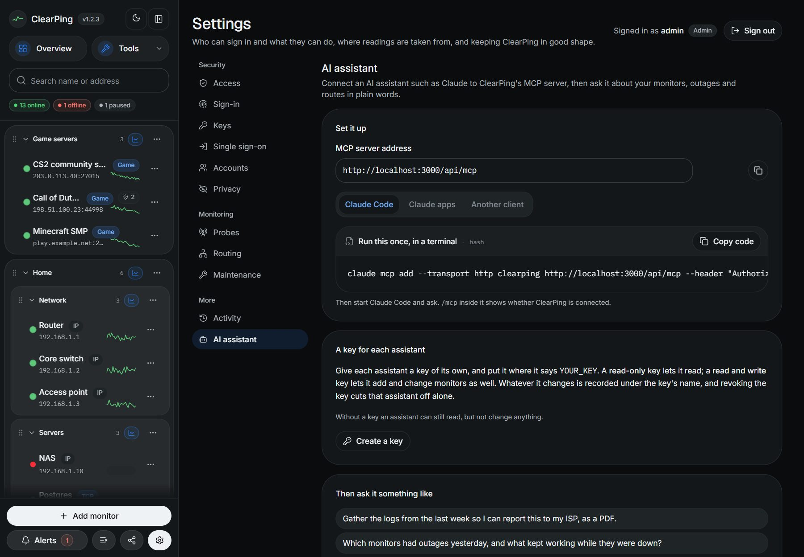

# Connecting an AI assistant (MCP)

ClearPing can be read by an AI assistant over the
[Model Context Protocol](https://modelcontextprotocol.io). Give the assistant
one address and it can answer questions from what ClearPing has recorded, the
way you would by reading the charts:

> Gather the logs from the last week so I can report this to my ISP, as a PDF.

The assistant asks ClearPing for the evidence and writes the report from it.

## Connecting



The address is `/api/mcp` on wherever your ClearPing is reached:

```
http://clearping.lan:3000/api/mcp
```

**Settings → AI assistant** (the cog at the foot of the sidebar, or
`/settings/assistant`) shows the address for your installation and what to do
with it.

**Claude Code.** Once, in a terminal:

```bash
claude mcp add --transport http clearping http://clearping.lan:3000/api/mcp
```

**Claude Desktop, for a ClearPing on your own network.** Claude Desktop starts
programs on the computer it runs on and talks to those, so it is given a small
bridge, [mcp-remote](https://github.com/geelen/mcp-remote), that passes
everything on to ClearPing. The bridge runs on your computer, and so reaches
whatever your computer can: `192.168…`, `clearping.lan`, `localhost`.

1. In Claude Desktop: Settings, Developer, Edit Config. That opens
   `claude_desktop_config.json` (`%APPDATA%\Claude\` on Windows,
   `~/Library/Application Support/Claude/` on a Mac).
2. Add ClearPing to it. If the file already lists servers, add only the
   `clearping` part inside its `mcpServers`:

   ```json
   {
     "mcpServers": {
       "clearping": {
         "command": "npx",
         "args": ["-y", "mcp-remote", "http://clearping.lan:3000/api/mcp", "--allow-http"]
       }
     }
   }
   ```

3. Save, quit Claude Desktop altogether, and open it again.

The computer needs Node.js 18 or newer, which is where `npx` comes from; the
bridge is fetched the first time it is used. `--allow-http` is what lets it
use an address that is not HTTPS, and is not needed for one that is.

**claude.ai, and connectors in the Claude apps.** Settings, Connectors, Add
custom connector, and paste the address. A connector added this way connects
from Anthropic's servers and not from your computer, so the address has to be
reachable from the internet. A ClearPing on a home or office network is not;
use Claude Desktop as above, or Claude Code, for one of those. A custom
connector also has no field for a token like ClearPing's, so it cannot connect
to one that asks for a token.

**Any other client.** Add it as a remote server over HTTP (Streamable HTTP):

```json
{
  "mcpServers": {
    "clearping": { "type": "http", "url": "http://clearping.lan:3000/api/mcp" }
  }
}
```

There is nothing else to install or run: it is part of the app.

## What an assistant can do

A monitor is called a *target* in the tools and their arguments, which have not
changed: `list_targets`, `add_targets`, `target`. A monitor measured from
several probes takes `probes` (a list of probe names or ids, with `local`),
and the tools that read or measure take a `probe` to say which of them.

As it comes, it can read and only read: no tool adds, changes, pauses or probes
a monitor, and nothing is sent anywhere. Alerts are left out altogether, since
where an alert is sent is usually a URL with a password in it.

| Tool | What it returns |
|---|---|
| `list_targets` | Every monitor: its address, probe, group, whether it is inside the local network, and how its latest probe went |
| `build_isp_report` | The evidence for a report to an ISP, in one call (below) |
| `get_incidents` | Every outage and spell of loss in a period, across monitors, with what the other monitors were doing meanwhile |
| `get_target_history` | One monitor in depth: its figures, its incidents, the gaps in monitoring, and how it did at each hour of the day |
| `get_traceroutes` | Saved routes hop by hop, with the hop at which replies stopped |
| `get_dns_resolvers` | For a DNS monitor that asks several resolvers: how each did, and what each last answered |

Each takes a period (`hours`, `days`, or `start` and `end`) and a `timezone`
to write times in, which is the time zone of the machine ClearPing runs on
unless another is given. Times are written as local time with the offset from
UTC on the end, `2026-10-13T14:02:00+02:00`, so they read naturally and are
still exact to someone in another zone.

There is also a ready-made prompt, `isp_report`, which is the whole request
written out: gather the evidence, then write it up in the order an ISP's
support desk needs it. It takes how many days to cover, the provider's name
and the format wanted.

### Letting it change things

Give an assistant a **read and write** key (Settings → Keys, see
[security.md](security.md)) and it gets five more tools:

| Tool | What it does |
|---|---|
| `add_targets` | Starts monitoring new monitors, up to 50 at once |
| `update_target` | Changes a monitor's name, group, interval, address, probe or settings |
| `set_target_paused` | Stops probing a monitor, or starts again |
| `probe_now` | Takes a reading straight away |
| `run_traceroute` | Traces the route to a monitor now and saves it; `ip_version` traces a name over `ipv4`, `ipv6` or `both` |

> Add my router, my ISP's gateway and 1.1.1.1 as ping monitors, in a group
> called Network.

A monitor needs only an address, read the way the form in the app reads it: a
URL is a web page to load, `host:port` a port to connect to, anything else a
ping. Everything added goes through the same check as that form, a list with a
mistake in it is turned away whole, and a monitor already monitored the same way
is passed over and reported, not added twice.

Two things are left out on purpose. Nothing here **deletes**: a monitor's whole
history goes with it and does not come back, so that stays a button for a
person to press. Pausing is the way an assistant stops something being
monitored. And **alerts** cannot be seen or changed.

Each of these tools is marked as one that changes something, so a client such
as Claude Code asks you before it runs one. To an assistant without such a key
they do not exist: the list it is given has only the six that read. Every call
to one is recorded under the key's name in Settings → Activity.

## The report

`build_isp_report` covers the last seven days unless told otherwise, and
returns:

- **How each monitor did**: probes taken, uptime, loss, latency, and how many
  outages and for how long in all.
- **Every outage**, with the time of the first probe that failed and of the
  probe that found it working again, why the probes failed, and **what the
  other monitors were doing meanwhile**.
- **The worst spells of packet loss**, and a count of the rest.
- **The period by hour of day**, for the monitors that had the most trouble. A
  line that is fine all morning and drops packets every evening shows here.
- **The traceroutes** saved in the period, those taken automatically as an
  alert fired first: the route through a failure, and the hop where replies
  stopped.
- **How each resolver did**, for DNS monitors that ask several.
- **When ClearPing itself was not running**, and what else the data cannot
  show.

An outage is a spell in which at least one probe got no reply at all; a spell
of loss is one in which every probe got a reply and some packets did not. One
healthy probe in the middle does not split an outage in two: it is over when
two probes in a row are healthy.

### What makes the report worth sending

The report is as good as what is monitored. The strongest evidence an ISP can
be given is contrast: your router answering throughout while their gateway and
everything past it did not. That takes a monitor at each step:

- **your router**, by its address on your network (`192.168.1.1`);
- **the ISP's gateway**, the first hop past the router in a traceroute;
- **one or two addresses out on the internet** (`1.1.1.1`, a site you use).

With the router in the list the report can say the fault was beyond your
network. Without anything inside the local network it says, plainly, that the
data cannot tell a fault in the building from one outside it. A loss alert on
the outside monitors is worth having too: a traceroute is saved automatically
when it fires, and that is the only time the route through a failure can be
captured.

The assistant is told to use only figures that are in the data, to keep the
caveats in, and to say so if the period shows no real problem.

## Keeping addresses from assistants

With **Hide addresses from AI assistants** on, under Settings → Privacy,
everything ClearPing gives an assistant has its IP addresses and host names
hidden: `203.0.113.10` becomes `•••.•••.•••.10`. What an assistant is given
goes on to whoever runs it, and this keeps your addresses out of it. Monitors
keep their names, so the assistant can still say which one went down and why.

## Keys

Each assistant gets a key of its own, made under Settings → Keys: **read only**,
or **read and write**, lasting a set number of days or with no expiry. Revoke
one and that assistant alone is cut off. Re-roll replaces it: the new key is
shown once and the old one stops at once. What each one changes is recorded
under its name. Send it with every request:

```bash
claude mcp add --transport http clearping https://clearping.example.com/api/mcp \
  --header "Authorization: Bearer cp_your-key"
```

For Claude Desktop the key goes in the bridge's settings. The header is
written without a space after the colon, and its value kept in `env`, because
Claude Desktop on Windows splits an argument at its spaces:

```json
"clearping": {
  "command": "npx",
  "args": ["-y", "mcp-remote", "http://clearping.lan:3000/api/mcp", "--allow-http",
           "--header", "Authorization:${AUTH_HEADER}"],
  "env": { "AUTH_HEADER": "Bearer cp_your-key" }
}
```

Without a key an assistant can read but never change anything, unless
**Require a key for AI assistants** is on under Settings → Access (it always is
while sign-in is on), and then it is refused altogether. A wrong, revoked or
expired key is refused either way. Settings → AI assistant writes the command with a
place for the key; it is never shown a key.

`CLEARPING_MCP_TOKEN`, the single token from before keys were made in the
dashboard, still works as a read and write key, and while it is set a key is
always asked for. Move to keys made in Settings and unset it.

### Keys are only taken encrypted

A key sent over plain HTTP across the internet can be read by anything on the
way, and whoever reads it can do what the key can. So a request carrying a key
is taken only if it is one of:

- **over HTTPS**, from anywhere. ClearPing in a datacentre and an assistant at
  home is this case: put it behind a proxy that does TLS
  ([reverse-proxy.md](reverse-proxy.md)), and give the assistant the
  `https://` address;
- **at an address on its own network**, over plain HTTP: `localhost`, a private
  address (`192.168…`, `10…`), or a local name (`clearping.lan`, `nas.local`).
  There is no internet in between to listen.

Anything else is refused with `403` before the key is looked at, and the
answer says that the key should be revoked and replaced, since it has already
travelled in the clear. Settings → AI assistant warns of this before it is
tried, when the page itself was opened over plain HTTP at a public address.

How it arrived is read from `X-Forwarded-Proto`, which a proxy has to pass on
(Caddy, Traefik, Cloudflare Tunnel and Tailscale Serve do; nginx needs
`proxy_set_header X-Forwarded-Proto $scheme`).
If something else encrypts the connection, a VPN or an SSH tunnel to a public
address, set `CLEARPING_MCP_ALLOW_HTTP=1` to say so.

This is a guard against sending a key in the clear by mistake, not what keeps
a stranger out: the key does that. A ClearPing reachable from the internet
should also have sign-in on, or a sign-in proxy in front; see
[security.md](security.md).

A web page is only let through from the address ClearPing itself was reached
at. Any other is refused, so that a website cannot have a visitor's browser
read a ClearPing on their private network. A page of your own on another
address can be added under Settings → Access → **Websites that may call the
API**; it then has to send a key, like any assistant (see
[security.md](security.md#websites-that-may-call-the-api-cors)).

The levels, in short: an assistant with no key reads, unless **Require a key
for AI assistants** is on; with a read-only key it reads; with a read and write
key it also changes monitors. Nothing deletes. To keep your readings from
assistants altogether, turn that switch on and only give keys to the ones you
trust, or hide addresses from them under Settings → Privacy.

## How it works

One address, `POST /api/mcp`, taking one JSON-RPC message and answering with
JSON. Nothing is kept between requests and nothing is streamed, so there is no
session, and a `GET` is answered `405`. It speaks protocol revisions
`2025-06-18`, `2025-03-26` and `2024-11-05`. It is written out in
[src/lib/mcp/protocol.ts](../src/lib/mcp/protocol.ts) with no SDK behind it;
the tools are in [src/lib/mcp/tools.ts](../src/lib/mcp/tools.ts), and what
turns readings into incidents in [src/lib/reports/outages.ts](../src/lib/reports/outages.ts).
