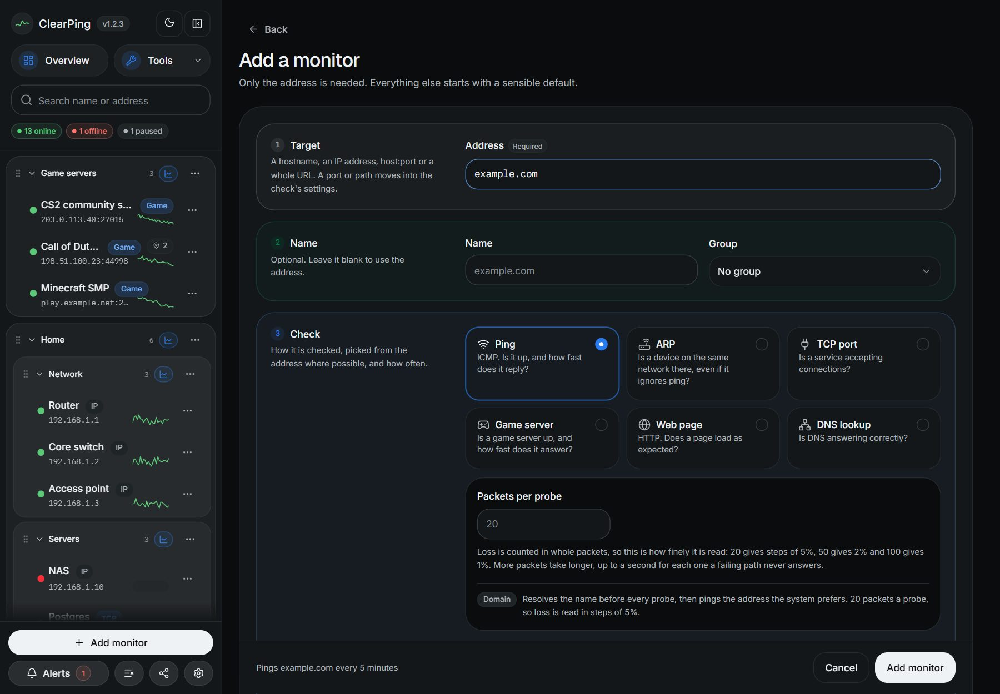
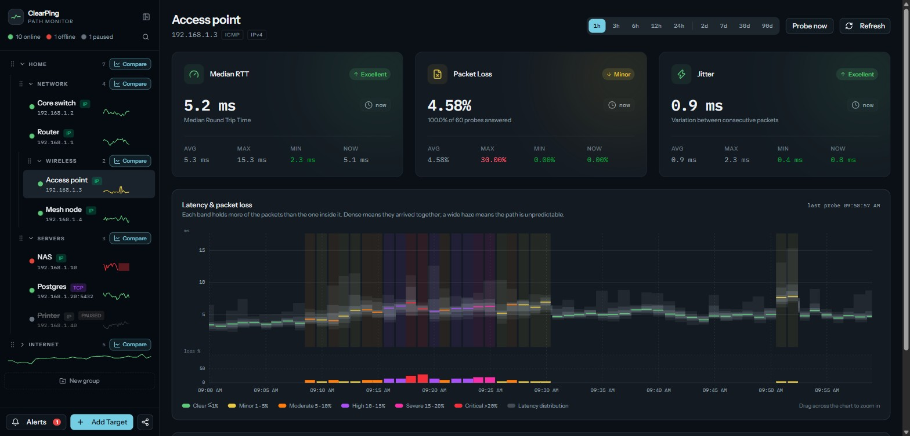
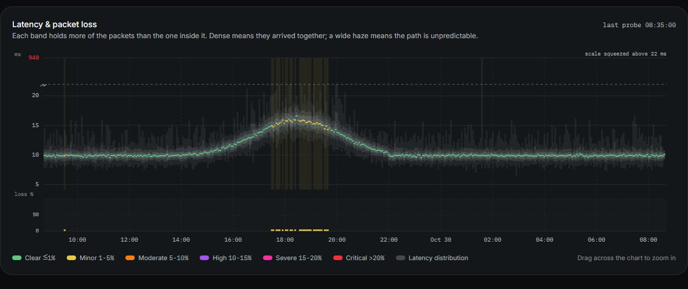
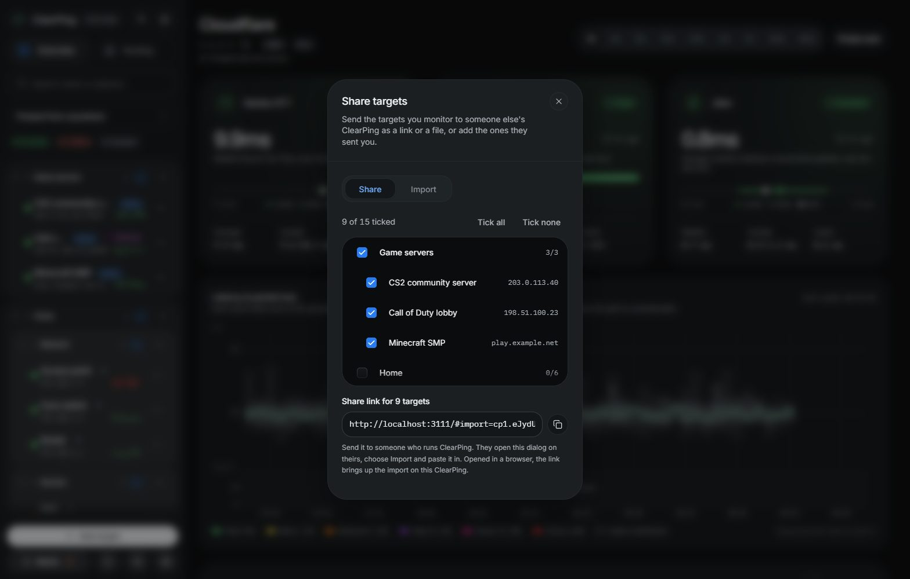

# Monitors

A **monitor** is one thing ClearPing measures: an address, a web page, a game
server, a DNS lookup or a port. Every monitor has a name, a way of checking it,
an interval, and a group in the sidebar. It is measured from one probe, or from
several (the local probe and any [probe agents](probe-agents.md)). What each
kind of check measures is in [automatic-probing.md](automatic-probing.md).

## Adding one

**Add monitor** (the + at the top of the sidebar) opens the add monitor page. Its sections are
numbered in the order the questions come up:

1. **Address.** A hostname, an IP address, `host:port` or a whole URL. The
   address is all it needs: a URL becomes a web page check, `host:port` a TCP
   port check, and anything else a ping. A port or path moves into the
   check's settings.
2. **Name.** Optional. Left blank, it is called by its address.
3. **Check**: Ping, ARP, TCP port, Web page (HTTP or HTTPS), DNS
   lookup or Game server, with the settings of that kind, and how often to
   measure it (every 30 seconds up to every hour; 5 minutes unless you change
   it).
4. **Probes**: the probes that measure it. The first one ticked is its
   **primary** probe, the one its page opens on.

The address and Enter are enough to add a monitor. Every monitor goes through
the same check, whether it is added here, by import, through the API or by an
assistant, and a monitor that is already measured the same way from the same
probe is not added twice.

**Duplicate**, in a monitor's menu in the sidebar, opens the same page filled
in from that one, for a monitor that differs only in its address or its
settings.

## A monitor's page

Click a monitor in the sidebar to open it.

- **The time range** at the top right: 1 hour, 3, 6, 12 or 24 hours, 2 days,
  7, 30 or 90 days. Drag across a chart to zoom in on part of it.
- **Measure now** takes a reading straight away, from the probe in view (or
  from every probe while they are being compared), without waiting for the
  interval.
- **The cards**: median latency, packet loss and jitter over the period, and
  how long ago the last reading was.
- **The chart**: each reading's median as a line, with the spread of its
  packets drawn as smoke around it, the way Smokeping draws it. Loss colours the
  line. A spike gets a band of its own along the top so it does not flatten
  everything else.

  

- **Which probe**: a monitor measured from several probes has a switch for
  them, and **Compare** draws every probe's line on one chart, which is how
  you tell a problem near one probe from a problem at the monitor itself.
- **IPv4 and IPv6**: a name measured over both has a line for each
  ([automatic-probing.md](automatic-probing.md#ipv4-and-ipv6)).
- **What the latest reading learned** beyond its timings: the status a web
  server answered with and where the time went, how long its certificate has
  left, what a DNS lookup answered, who is playing on a game server, and, when
  it failed, why.
- **Packet loss analysis**, under the cards whenever the period has loss,
  folded until it is opened: how the lost packets are spread, the hours of the
  day they fall in, and which other monitors lost packets at the same time.
  That last part is what tells a fault on your own network from one at the
  ISP or beyond.
- **Who runs the address**: the network it belongs to (its ASN, a link to
  IPinfo), the name it is registered under, and the internet exchange it is
  on, when it is on one. Turned off with **Look up who runs each address** under
  Settings → Privacy, and never asked for a private address
  ([security.md](security.md#privacy)).
- **Traceroutes**: the saved routes to it, hop by hop, with the hop where
  replies stopped. **Trace** takes one now; an alert can take one by itself
  when it fires ([automatic-probing.md](automatic-probing.md#traceroute)).
- **DNS monitors** that ask several resolvers show a row for each, so the same
  lookup can be compared resolver by resolver
  ([automatic-probing.md](automatic-probing.md#dns-settings)).

A closed-port check that has never had an answer is shown grey rather than
down: some firewalls drop packets to closed ports without a word, so the check
cannot measure that server. The page says so, and offers the last hop that did
answer in a traceroute as a ping monitor to watch instead.

## Changing, pausing and deleting

Each monitor in the sidebar has a menu: **Copy address**, **Pause** (or
**Resume**), **Edit**, **Duplicate** and **Delete**.

- **Pause** stops it being measured and keeps everything it has recorded.
  This is the way to stop watching something for a while.
- **Delete** removes the monitor and every reading it ever had, and cannot be
  undone. The delete dialog offers to pause it instead.
- **Several at once**: **Delete several monitors**, a button at the top of
  the sidebar, finds monitors with the
  search, ticks them one by one or a group at a time, and deletes them
  together. Nothing starts ticked, and the button has to be held down.

Monitors are dragged to put them in order, or into another group.

## Groups

Every monitor sits in a group, and groups can sit inside each other
(`Home/Network`). A group can be compared on one chart, given a probe across
all its monitors, and told which probes ask which DNS resolvers. See
[automatic-probing.md](automatic-probing.md#groups) and
[automatic-probing.md](automatic-probing.md#comparing-monitors).

## Sharing monitors with another ClearPing

**Share or import monitors**, a button at the top of the sidebar, sends monitors to another ClearPing, and takes in
the ones another sent. Tick the monitors, then make:

- **a link**, which is the list itself. Nothing is kept on the server for it,
  so the two ClearPings never need to reach each other: paste the link into
  the other one's browser. The monitors travel after the `#` in the link, the
  part a browser never sends to a server, so they do not end up in a server's
  log either.
- **a file**, which can also be kept as a backup, or sent where a link cannot
  go. The same dialog on the other side reads it.

Either one carries what the monitors are, never what they have recorded, and
never an alert, since where an alert is sent is usually a URL with a password
in it. Everything is checked before anything is added, and nothing is added if
one is wrong. A monitor measured from a probe agent the other ClearPing does
not have is pointed out, by the probe's name, so it can be set up there.

## Several probes for one monitor

A monitor can be measured from several probes at once: the local probe and any
probe agents ([probe-agents.md](probe-agents.md)). Two tools in Settings help:

- **Add a probe to monitors** (Settings → Probes) measures monitors that
  already exist from one more probe, such as a probe agent just set up: every
  monitor, or one group. Each keeps the probes it has, and its first stays its
  first.
- **Duplicate monitors**: monitors made before one monitor could have several
  probes, the same host set up once for each place, are offered for merging
  into one, never merged unasked. A notice on the dashboard says when there are
  any.

## From a script or an assistant

Everything here can be done through the HTTP API, under `/api/monitors`
([api.md](api.md)), and most of it by an AI assistant with the
`list_monitors`, `add_monitors`, `update_monitor`, `set_monitor_paused`,
`probe_now` and `run_traceroute` tools ([mcp.md](mcp.md)). Nothing an
assistant does can delete a monitor.
