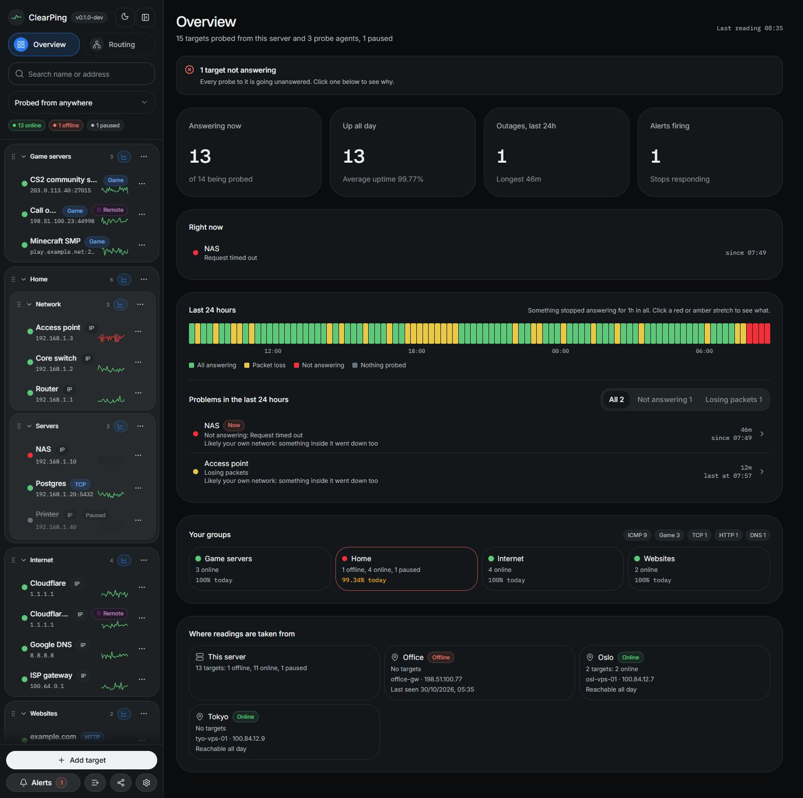

# The overview

**Overview**, at the top of the sidebar, is where ClearPing opens: the whole
network at a glance. It runs from what matters most to what matters least, and
every problem on it is one click from the target it was on.

## What is on it

- **A summary** under the title: how many targets are probed from this server
  and from probe agents, and how many are paused. If anything is wrong, a card
  under it says so, and which targets.
- **Four figures.** *Answering now* (of the targets being probed), *Up all
  day* with the average uptime, *Outages, last 24h* with the longest, and
  *Alerts firing*.
- **Right now.** Each target that is not answering, with why (as its probe
  said it) and since when.
- **Last 24 hours.** A strip of quarter hours: green when every target probed
  in it answered, amber when some lost packets, queries or requests, red when
  some got no reply at all, and grey when nothing was probed. Click a red or
  amber stretch to list only who had trouble then.
- **Problems in the last 24 hours.** Every target that had trouble, whether it
  stopped answering or lost packets, why, for how long, how many times, and
  whether it is still going on. A probe agent that could not be reached has a
  row of its own, listing its targets: they took no readings meanwhile, so
  they are not counted as down. Filter by *Not answering* or *Losing packets*.
  Click one to go to that target.
- **Your groups**, each as a tile with how many of its targets are online and
  its uptime today, and how many targets there are of each kind.
- **Where readings are taken from.** This server and each probe agent, with
  how it is doing, how many targets it probes and when it was last seen.
- **Routing**, while BGP monitoring is on: the prefixes watched and how each
  stands ([bgp-monitoring.md](bgp-monitoring.md)).

## Where the fault lay

When the line goes down, twenty targets each have an outage at 12:49, and a
list of twenty outages hides the one thing worth knowing: it was one fault. So
problems that start within a couple of minutes of each other, among targets
probed from the same place, are one event, and the event says where the fault
probably lay, from what else was answering at the time:

| Says | When |
|---|---|
| *Likely your own network: something inside it went down too* | A target on a private address, or a local name, was among them |
| *Only this target: everything else probed from here kept answering* | One target went wrong while others being probed from the same place did not |
| *Out on the internet: N other targets went too, while your own network kept answering* | Several targets failed, and a target inside your own network answered throughout |
| *Along with N other targets probed from here* | Not enough was being probed from that place to say |

For a target probed from a probe agent, "here" and "your own network" are that
agent's: the same judgement, made from where it is.

The problems themselves are found the way the AI assistant's report finds them
([mcp.md](mcp.md)). The judgement of where the fault lay is only as good as
what is monitored. Add your router as a target as well as addresses beyond it,
and the Overview can tell a fault inside your network from one outside it.

## What is left out

- A spell of packet loss shorter than ten minutes is counted, not listed: a few
  dropped packets now and then are ordinary.
- A closed-port game server check that has never had an answer is left out: all
  it has done is fail, which says nothing about its server.
- A paused target is not probed, so it is not counted as answering or not.

## API

`GET /api/overview` answers the same as JSON: each target's uptime, the events
with where each fault lay, and how many targets were watched, down and losing
packets in each quarter of an hour. What is going on right now is in
`GET /api/targets?packetLoss=true`, which the sidebar uses too.
