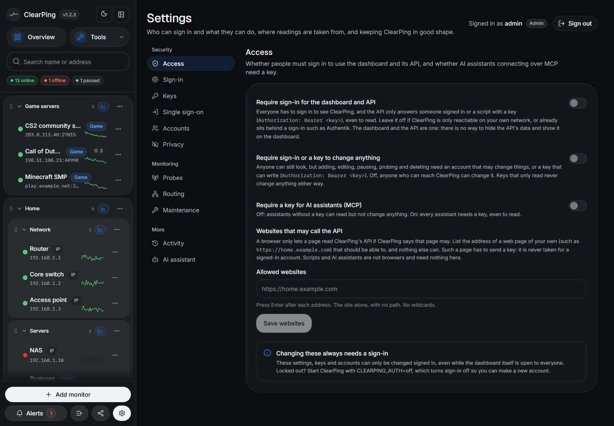
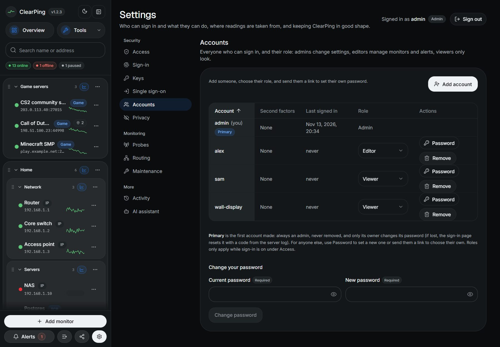
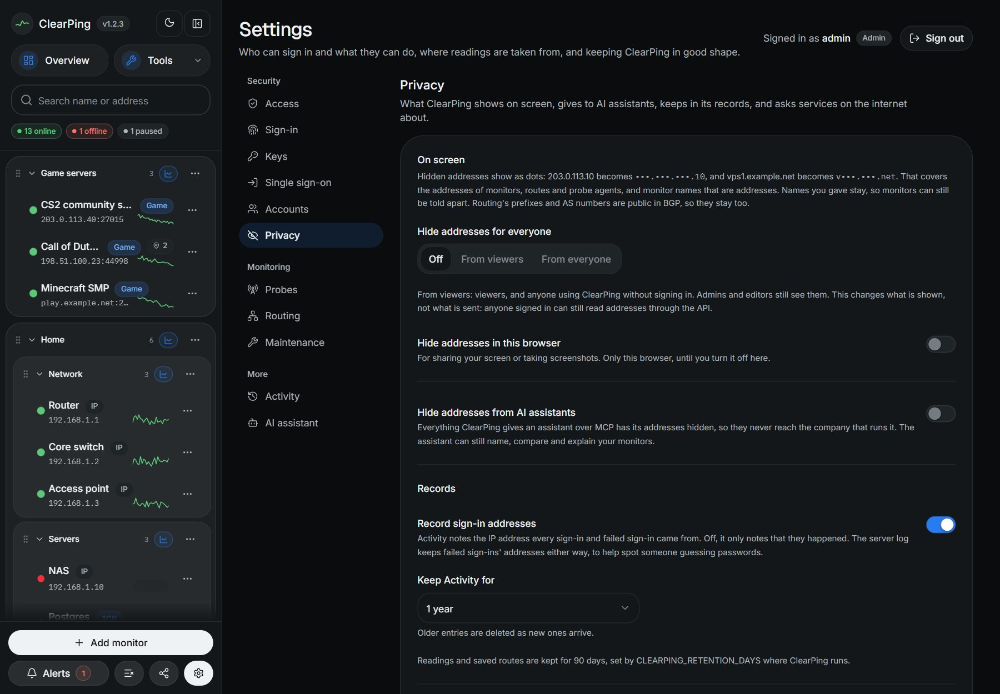

# Security: sign-in, roles, keys and activity

Everything here is optional and starts off. Out of the box ClearPing is as it
always was: anyone who can reach it can use it, which is fine on your own
network or behind a sign-in proxy such as Authentik. For anything else, the
**Settings** page (the cog at the foot of the sidebar, or `/settings`) sets up:

- **Sign-in** for the dashboard and its API, with accounts.
- **Roles**: admins, editors who change what is monitored, viewers who look.
- **Keys** for scripts and AI assistants: one each, able to read or to read and
  change.
- **Activity**: a record of every change, and which account or key made it.
- **Single sign-on** with Authentik, or any OpenID Connect provider.

## Setting it up



1. Open **Settings** (the cog, bottom of the sidebar) and choose **Create an
   account**. The first account is made on the sign-in page; after that the
   page offers only to sign in, and more accounts are added in Settings →
   Accounts. Each section has an address of its own: `/settings/keys`,
   `/settings/sso`, `/settings/accounts`, `/settings/activity`,
   `/settings/assistant`.
2. Under **Access**, turn on **Require sign-in for the dashboard and API**.
3. Under **Keys**, create a key for each assistant or script that needs one.

The first time the dashboard opens with sign-in still off, it asks you to turn
sign-in on or set up single sign-on. An admin can instead say it stays on the
network, and the question goes away for everyone. Turning sign-in on removes
it too. Single sign-on on its own leaves the question up: the dashboard and
the API stay open until sign-in is required. With `CLEARPING_AUTH=off` the
question stays away, because that is how you get back in.

Changing anything under Settings always takes being signed in, even while
sign-in is off for the dashboard. Otherwise anyone who could open the page could
make themselves a key. A key can never change these settings.

## Before anyone can reach it

Sign-in is off until it is turned on, so a new install is open to whoever
reaches it. These close what that leaves:

- **The first account asks for a setup code.** Made at start-up and written to
  the server's log (`docker logs clearping`), or `CLEARPING_SETUP_CODE` if you
  set it. Without it, whoever got to the sign-in page first would be the admin.
- **Changes from other websites are refused,** signed in or not. A browser says
  which site a request came from (`Origin`, `Sec-Fetch-Site`), and one from
  anywhere but ClearPing's own pages is turned away. Keys and scripts, which
  send neither, are not affected.
- **`CLEARPING_ALLOWED_HOSTS`** lists the names ClearPing answers to, and a
  page that points its own domain at your machine (DNS rebinding) is refused.
  Unset, ClearPing answers at an IP address, at `localhost`, at a name of one
  word or on a private ending such as `.lan`, `.local` or `.internal`, and at
  the name single sign-on is set up with. Any other name is answered only once
  sign-in is on, since a browser at that name would have no session to use. So
  a public domain with sign-in off has to be listed here.
- **`CLEARPING_TRUST_PROXY`** says how many proxies in front of ClearPing can be
  believed about the address a request came from. Left at 0, `X-Forwarded-For`
  is ignored and failed sign-ins are counted per username only, apart from a
  browser that has signed in to that account before, which has a count of its
  own so that nobody can keep you out by failing on purpose.
- **Where alerts are sent is hidden from anyone not signed in,** since the URLs
  carry tokens. Saving an alert you were shown redacted keeps its real URLs.
- **Alerts are not sent to link-local or cloud metadata addresses,** such as
  `169.254.169.254`. With sign-in off, anyone who can reach ClearPing can still
  point an alert at another machine on your network: another reason to turn it on.
- **Pages cannot be framed by other sites,** and run only the scripts ClearPing
  wrote for them. Over HTTPS, browsers are told to keep using it.

## Roles



Every account has one of three roles, set by an admin in **Settings →
Accounts** (or by Authentik groups; see below):

| | Admin | Editor | Viewer |
|---|---|---|---|
| See monitors, charts, routes, incidents | yes | yes | yes |
| See alerts | yes | yes | yes, without the tokens in where they are sent |
| Add, change, pause and delete monitors and groups; probe; trace | yes | yes | no |
| Make, change and delete alerts | yes | yes | no |
| Create keys | any | of its own | of its own, read only |
| Revoke keys | any | its own | its own |
| Change its own password, link its own account to single sign-on | yes | yes | yes |
| Sign-in, single sign-on settings, accounts and roles, the activity record | yes | no | no |

- The first account is an admin, and so is one made with
  `CLEARPING_AUTH=off` to get back in. Accounts that were here before roles
  are admins: nothing changes for them.
- An account an admin adds is a **viewer** unless they choose otherwise.
- The first account made is the **primary** one. It is always an admin, and
  cannot be removed or made anything else, by anyone (see Forgotten password).
  So there is always an admin.
- A change of role takes effect at once, on the next request, without
  signing in again.
- A viewer's dashboard leaves out what it may not do (Add monitor, editing,
  Measure now, Trace route, the alerts' buttons), and the server refuses it
  anyway.
- Roles are about a ClearPing that asks for sign-in. With sign-in off,
  anyone who can reach it can change anything without signing in, as before.

**A key never does more than the account that made it.** A viewer's keys only
read. An editor made a viewer has keys that only read from the next request;
made an editor again, they change things again. Removing an account revokes
its keys. Keys made before roles have no maker on record and do what they were
made to.

## What sign-in covers

With **Require sign-in** on:

- Every page needs a signed-in account; anyone else is sent to `/login`.
- Every API route needs a signed-in account **or a key**, sent as
  `Authorization: Bearer <key>` (or `X-API-Key: <key>`):

  ```bash
  curl -H "Authorization: Bearer cp_…" https://ping.example.com/api/targets
  ```

- The MCP address needs a key too: an open MCP address would hand out what
  sign-in protects.
- Left open: `/login` and `/api/auth/*`, `/api/health` (for the container's
  health check; it says nothing about what is monitored), `/api/mcp/info`, and
  the icons, manifest and offline page the sign-in page needs.

Sessions last 30 days from the last visit, and end on the server when you
sign out. The cookie, `clearping.session_token`, is signed, `HttpOnly`,
`SameSite=Lax`, and `Secure` over HTTPS. A change made with the cookie has to
come from a page of this site; one sent from another site is refused. Sign-in
failures are slowed down after five tries, per address and per username, up to
a quarter of an hour.

## The API and who may call it

**Settings → Access** has three switches that decide who may call the API (and
the dashboard, which is the same thing: it is the API's only client):

| Setting | Looking (`GET`) | Changing (`POST`, `PUT`, `PATCH`, `DELETE`) |
|---|---|---|
| Both off (the default) | anyone | anyone |
| **Require sign-in or a key to change anything** | anyone | a signed-in account that may change things, or a key that may write |
| **Require sign-in for the dashboard and API** | a signed-in account or any key | as above |

- With the middle row, the dashboard opens for anyone as a read-only view, as a
  viewer sees it, and **Settings** is where they sign in to change things. A
  wrong key is still refused, and a read-only key still cannot change anything.
- The API's data cannot be hidden while the dashboard shows it: both are the
  same calls. To hide reads, require sign-in. That is also why the switches
  cannot tell a script from the dashboard when sign-in is off: a browser's headers
  can be copied by anything.
- **AI assistants (MCP)** have their own switch, **Require a key for AI
  assistants**, which makes even reading need a key. Writing always needs a key
  that may write; there is no writing without one. See [mcp.md](mcp.md).
- Every key has one of two levels, **read only** or **read and write**, chosen
  when it is made and never more than its maker may do.
- `CLEARPING_AUTH=off` turns all of these off while it is set, as it does
  sign-in.

### Websites that may call the API (CORS)

A browser stops a page from one site reading another's API unless that API
allows it. **Websites that may call the API**, under Settings → Access, lists
the addresses (`https://home.example.com`, the site alone, with no path) whose
pages may. Nothing is allowed until listed, and there is no wildcard: it would
let any page a visitor opens read a ClearPing on their private network.

- A listed page may call the API, and the MCP address, from the browser, and
  read the answers. It is **never taken for a signed-in account**: its requests
  are read without the session cookie, so it has to send a key
  (`Authorization: Bearer <key>`). The key's level (read only, or read and
  write) decides what it can do.
- Sign-in itself (`/api/auth/*`), the settings (`/api/security/*`, which no key
  can change) and the health check stay closed to other sites.
- No credentials are ever allowed across sites, so the answer to a page never
  includes anything tied to the visitor's login.
- Changes are recorded in Activity.
- Scripts, `curl` and AI assistants are not browsers and need none of this.

A page that is not listed, or is listed but sends no key where one is needed,
is turned away as before, and a change from another site that is not listed is
refused whether or not anyone is signed in.

### Better Auth

Accounts, passwords, sessions, keys and the sign-in through Authentik are run
by [Better Auth](https://better-auth.com), kept in its own tables in
ClearPing's database. ClearPing adds its rules on top: the roles, the last
admin, keys that never outdo their maker, who may sign in through Authentik and
as what, signing out together with Authentik, and the activity record. Better
Auth's own HTTP endpoints are not open to the browser; ClearPing's routes call
it on the server, so nothing gets round those rules.

The cookies are signed with `BETTER_AUTH_SECRET` where that is set. Otherwise
a secret is made at the first start and kept in the database, so nothing has
to be set. Set it yourself only to keep sessions working across a database
that is replaced.

**Upgrading from a version before it** (0.1.x): the first start moves
everything across, once.

- Accounts keep their passwords, roles and links to Authentik.
- Keys keep working, unchanged.
- Everyone signs in once more: sessions are not moved.
- Nothing changes in Authentik: the redirect URI stays
  `/api/auth/sso/callback`. Its provider does need a signing key now (see
  below).
- The old tables (`users`, `sessions`, `api_keys`) are left in the database,
  unread, in case the upgrade has to be undone.

## Second factors

Accounts that sign in with a password can add a second factor under
**Settings → Sign-in**. Accounts that sign in through Authentik use
Authentik's own second factor instead, and are not shown these.

- **An authenticator app.** Scan the QR code with 1Password, Google
  Authenticator, Authy or the like, and type a code from it to turn it on.
  From then on, signing in asks for a code after the password. Ten backup
  codes are shown once, at setup, each good for one sign-in if the phone is
  lost; new ones can be made, which ends the old. *Trust this browser* skips the
  code there for 30 days. Ten wrong codes in a row stop the account finishing a
  sign-in for a quarter of an hour.
- **Passkeys.** Sign in with a fingerprint, face or device PIN, with no
  password or code to type. Browsers make passkeys only for a site name over
  HTTPS, or for `localhost`: not at an address such as `192.168.1.10`. A
  passkey works at the name it was made at, so make it at the address you
  normally use. The sign-in page offers passkeys once one exists. Adding one
  is done within a day of signing in; after that, sign in again first.

### Requiring them

An admin chooses, under **Settings → Sign-in**, what every account that signs
in with a password must have:

| Required | Satisfied by |
|---|---|
| Nothing more than a password | anything |
| An authenticator app or a passkey | either one |
| An authenticator app | the app |
| A passkey | at least one passkey |
| An authenticator app and a passkey | both |

and whose accounts: **editors and viewers**, or **everyone, admins too**.
An account without what is required is sent to a page that asks for it the
next time it opens ClearPing, and until it has added it, the dashboard and API
answer it with nothing else. Nobody can remove a factor they are required to
have, and an admin cannot require of everyone something their own account does
not have yet: that is how an admin would lock themselves out. If it happens
anyway, `CLEARPING_AUTH=off` (below) lifts the requirement while it is set.

What is required is asked for at every sign-in, not only checked to exist:

| Required | Signing in with a password | Signing in with a passkey alone |
|---|---|---|
| An authenticator app or a passkey | then the code, or the passkey if there is no app | yes |
| An authenticator app | then the code | not once the account has the app |
| A passkey | then the passkey | yes |
| An authenticator app and a passkey | then the code, then the passkey | not once the account has the app |

A passkey only works at the name it was made at, so an account required to use
one has to sign in at that name. Sessions made before this rule stay signed in
until they end.

Both factors are Better Auth's, its two-factor and passkey plugins, called
from ClearPing's routes like the rest of sign-in.

## Keys

| | Read only | Read and write |
|---|---|---|
| API: `GET` | yes | yes |
| API: `POST`, `PATCH`, `PUT`, `DELETE` | no (`403`) | yes |
| MCP: the tools that read | yes | yes |
| MCP: `add_targets`, `update_target`, `set_target_paused`, `probe_now`, `run_traceroute` | no | yes |
| Settings | no | no |
| Ever more than the account that made it | no | no |

- Give each script or assistant **its own key**. Then one can be revoked
  without touching the others, and the activity record names which one did
  what: *GPT added monitors* rather than *someone did*.
- A key is shown **once**, when it is made, and only a hash of it is kept.
  Lost, it is revoked and replaced.
- When you make one, choose how long it lasts: 1 day, 7 days, 30 days, 90
  days, 1 year, or no expiry. An expired key stays in the list, marked
  expired, and stops working. It is refused the same way as a revoked one.
- **Re-roll** makes a new key with the same name, level and lifetime, shows it
  once, and revokes the old one at once. Update whatever was using it.
- Revoking stops it at once. The key stays in the list, marked revoked, so the
  activity it was used for still says whose it was.
- Over MCP, a key is only taken over HTTPS or from ClearPing's own network; see
  [mcp.md](mcp.md#keys-are-only-taken-encrypted).
- **Keys are honoured whether or not sign-in is on.** With sign-in off, a key is
  what lets an assistant change things over MCP, and what puts a name to API
  changes in the activity record. A wrong, revoked or expired key is always
  refused, never treated as nobody.

`CLEARPING_MCP_TOKEN`, from before keys were made in the dashboard, still
works, as a key that can change things, and while it is set the MCP address
always asks for a key. Keys made in Settings are better: one per assistant,
revocable without a restart, named in the record. Move to them and unset it.

## Activity

**Settings → Activity** lists, newest first:

- monitors added, imported, changed, paused, resumed and deleted;
- groups made, renamed and deleted; alerts made, changed and deleted;
- every change an assistant made over MCP, with what it was asked to do;
- keys made, re-rolled and revoked, accounts added and removed, roles changed (and by
  whom: an admin, or the person's groups at Authentik), passwords changed,
  passwords an admin set for someone else, reset codes asked for and passwords
  reset with them, sign-in turned on and off;
- authenticator apps turned on and off, backup codes remade, passkeys added
  and removed, and changes to what is required;
- sign-ins, with how (a password, an authenticator code, a backup code, a
  passkey), and failed sign-ins with the address they came from.

Each entry says who (the account, the key, or *Anonymous* while sign-in is off)
and how it arrived: the dashboard, the API or MCP. Entries are kept for a year,
or as long as **Settings → Privacy** says (30 days, 90 days or a year).

## Privacy



**Settings → Privacy** decides what ClearPing shows, hands to AI assistants,
keeps and asks of the internet. Anyone can open it; only an admin changes what
applies to everyone.

- **Hide addresses on screen**: off, from viewers (and anyone using ClearPing
  without signing in), or from everyone. IP addresses and host names show as
  dots, keeping just enough to tell them apart: `203.0.113.10` is
  `•••.•••.•••.10`, `vps1.example.net` is `v•••.•••.net`. It covers monitors,
  traceroutes and probe agents, and monitor names that are addresses. Routing's
  prefixes and AS numbers are public in BGP, so they stay. This changes what is
  shown, not what is sent: anyone signed in can still read addresses through
  the API.
- **Hide addresses in this browser**: the same, for one browser only, for
  sharing a screen or taking screenshots. Anyone can turn it on for themselves.
- **Hide addresses from AI assistants**: everything ClearPing gives an
  assistant over MCP has its addresses hidden, so they never reach whoever runs
  the assistant. The assistant can still name, compare and explain monitors.
- **Record sign-in addresses**: on by default. Off, sign-ins and failed
  sign-ins in Activity no longer say the IP address they came from. The server
  log keeps failed sign-ins' addresses either way, to spot someone guessing
  passwords.
- **Keep Activity for**: 30 days, 90 days or a year.
- **Check for updates**: on by default. Off, ClearPing never asks GitHub's
  container registry whether a newer version is out (the same as
  `CLEARPING_UPDATE_CHECK=off`).
- **Look up who runs each address**: on by default. A monitor's page shows which
  network holds the address it is measured at, such as AS64500 and the name it
  is registered under (a link to IPinfo), and the internet exchange it is on.
  That asks RIPE NCC about the one public address, never a private one, and
  keeps the answer for a day. Off, nothing is asked and the page says nothing
  about who runs it. While addresses are hidden on screen the link goes to the
  network, not the address. The same switch finds each probe's country and
  network (Settings → Probes → Locations), from a probe agent's public address
  or the first router on the internet in a route traced from the probe: one
  address per probe, kept for six hours. Off, each probe's place is only what
  is typed in.

How long readings and saved routes are kept is set where ClearPing runs, with
`CLEARPING_RETENTION_DAYS` (90 days unless set); the page shows it.

## Passwords

Passwords are never stored, only a hash of each: scrypt, with a random salt of
its own for every password, so two accounts with the same password have
different hashes and a stolen copy of the database has to be guessed at one
account at a time. Usernames are kept as they are. They name an account rather
than prove anything, and an admin needs to read them to manage accounts.

## New accounts and password links

**Settings → Accounts → Add an account** opens the form for a new one. Its
password is set one of two ways:

- **They choose it, with a link.** ClearPing gives the admin a one-time link
  to send on, by chat or email. It opens the sign-in page, where its owner
  chooses a password, so the admin never knows it. Until then the account has a
  long random password nobody is shown, so nobody can sign in to it.
- **I set it now.** The admin types a password and passes it on.

A link works once, for 48 hours, and is shown only when it is made. It is a
Better Auth reset code like the primary account's (below), kept and checked by
Better Auth; only its lifetime is longer. The code is after the `#` in the
link, the part a browser never sends to a server, so it stays out of request
logs, and the sign-in page takes it out of the address bar as soon as it opens.

## Forgotten password

**Any account but the primary one:** an admin presses **Password** beside it in
**Settings → Accounts**, and either makes a new link for them to choose a
password with, or sets one and passes it on. A new link replaces any made for
the account before. Setting a password signs the account out everywhere and
ends any link it had; so does using a link. An account made through single
sign-on can be given its first password the same way. No admin can do either
for the primary account, or for their own (that is changed under *Your
account*, with the current one).

**The primary account** is the first one made, when ClearPing was set up. On
an install from before there was one, it is the oldest admin. It is always an
admin, cannot be removed, and is marked *Primary* in the list of accounts.
Its password is reset with a code from the server's log, which only whoever runs
the server can read. On the sign-in page, **Forgot your password?** asks for the
username and writes the code to the log:

```bash
docker logs clearping 2>&1 | grep "reset code"
```

```
[Sign-in] Password reset code for "adam": Xk3…  (works once, for 15 minutes; …)
```

Type the code and a new password on the page. The code works once, within 15
minutes, and the account is signed out everywhere else. Reading the log takes
access to the machine ClearPing runs on, which is what the code proves. Asked for
any other account, no code is written. The page answers the same either way,
and the same for an account that does not exist; the log says which. It works
while password sign-in is on. An account with an authenticator app still asks
for its code afterwards.

**Why a sign-in failed.** The page only ever says *Wrong username or password*,
so as not to tell anyone which accounts exist. The log says why:

```
[Sign-in] "adam" from 203.0.113.7 was refused: the password is wrong
[Sign-in] "adma" from 203.0.113.7 was refused: there is no account by that name
[Sign-in] "adam" from 203.0.113.7 was refused: the account has no password: it signs in through single sign-on
```

An account made by signing in through single sign-on has no password until one
is set; a reset code sets its first.

## Locked out

If password sign-in is turned off, or the log cannot be read, start ClearPing
with `CLEARPING_AUTH=off`:

```bash
docker run … -e CLEARPING_AUTH=off ghcr.io/adamg100/clear-ping:latest
```

While it is set, sign-in is not asked for, whatever the switch says, and the
sign-in page offers to make a new account. Make one, sign in, change what needs
changing (remove the old account, or change its password from that account),
then remove the variable and restart. Nothing is deleted along the way.

## Single sign-on with Authentik

ClearPing can sign people in through Authentik, or any other OpenID Connect
provider (Keycloak, Entra ID, Google and so on): a **Sign in with Authentik**
button on the sign-in page, with no password to keep for ClearPing.

### In Authentik

1. **Applications → Applications → New Application.** If that button has a
   menu, choose **with New Provider**. The wizard creates the application and
   the provider together.
2. Name the application. Its slug is the last part of the issuer, such as
   `clear-ping`.
3. Choose provider type **OAuth2/OIDC**.
4. On the provider step:
   - Client type: **Confidential**.
   - Redirect URI: mode **Strict**, the one shown under Settings → Single
     sign-on, which is `https://<your ClearPing>/api/auth/sso/callback`. Open
     that page at the address people will use, since the URI is taken from it.
   - Signing key: pick one (the self-signed certificate is fine). ClearPing
     checks every sign-in against Authentik's published keys, so one is
     needed: without it Authentik signs with the client secret, which is not
     accepted.
   - Scopes: the defaults (`openid`, `email`, `profile`). `profile` is where
     Authentik puts the username and the person's groups.
   - Skip bindings, unless only some people should see ClearPing on their
     Authentik home page.
5. Open the provider the wizard created. Copy its **Client ID** (the long
   value, not the slug), **Client Secret**, and **OpenID Configuration
   Issuer**, which looks like
   `https://auth.example.com/application/o/clear-ping/`. That is the issuer,
   not the OpenID Configuration URL.

### In ClearPing

1. Settings → **Single sign-on**: paste the issuer, client ID and client secret.
   **Check the issuer** confirms Authentik can be reached there.
2. Optionally, **Only members of this group**: an Authentik group name. Only
   its members can sign in through Authentik at all.
3. **Save**, then turn on **Show "Sign in with Authentik"**.
4. **Link my account**: signs in through Authentik once and ties your existing
   account to that identity, so it is you who signs in rather than a new
   account.
5. Optionally turn off **Allow signing in with a password**, leaving Authentik
   as the only way in. It can only be turned off once your own account is
   linked, and `CLEARPING_AUTH=off` turns passwords back on if Authentik is
   ever unreachable.

With **Create an account at first sign-in** on (the default), someone signing in
through Authentik for the first time gets an account under their Authentik
username. If that name is already taken here, a number is added; an existing
account is never taken over because a name matches. Off, only accounts that
have been linked can sign in this way.

### Roles from Authentik groups

Under **Roles from groups (optional)**, name a group for admins and one for editors:

- At every sign-in through Authentik, the account's role is set from the
  person's groups: in the admin group, an admin; in the editor group, an
  editor; in neither, a viewer. A change of groups in Authentik is a change of
  role here at their next sign-in.
- The last admin is never made anything else this way; the activity record
  says the role was kept, and why.
- Left empty, Authentik has no say: roles are set in Settings → Accounts, and
  an account made at its first sign-in starts as the role chosen there (a
  viewer, unless changed).

Authentik sends the groups with `profile`, which ClearPing asks for, so there
is nothing to set up on that side beyond the groups themselves.

### Signing out, both ways

**Signing out of Authentik signs you out of ClearPing.** In the provider (Authentik
2025.8 or later), set:

- **Logout URI**: `https://<your ClearPing>/api/auth/sso/logout`, which Settings →
  Single sign-on shows to copy.
- **Logout method**: **Back-channel**.

Authentik then tells ClearPing, server to server, whenever a sign-in there
ends: when you log out of Authentik, when an administrator ends your session,
and when your account is deactivated. ClearPing ends the session made from that
sign-in, and records it in the activity. Only sessions made through Authentik
are ended; a session signed in with a password is not Authentik's to end.
Authentik has to be able to reach that address. On a home network it usually
can.

**Signing out of ClearPing signs you out at Authentik.** With **Signing out of
ClearPing signs out of Authentik too** on (the default), signing out of a session
made through Authentik goes on to Authentik's end-session page. What that ends
is the provider's **invalidation flow** (Advanced flow settings):

- `default-provider-invalidation-flow`, the default, ends only ClearPing's
  session at Authentik. You stay logged in to Authentik and its other
  applications, so **Sign in with Authentik** signs you straight back in.
- `default-invalidation-flow` logs you out of Authentik itself, and with it
  every application that has back-channel logout set up.

To come back to ClearPing's sign-in page afterwards rather than stay on
Authentik's, add `https://<your ClearPing>/login` to the provider's **Post
logout redirect URIs**. Without it, Authentik stays on its own signed-out page.

With the switch off, signing out of ClearPing ends only ClearPing's session.

### How it is checked

The authorization code flow with PKCE, run by Better Auth. The browser goes
to Authentik with a random state, nonce and PKCE challenge, and the answer is
taken only if its state is the one this browser was given. The code is traded
for an ID token directly with Authentik, using the client secret and the PKCE
verifier, and the token's signature (against Authentik's published keys),
issuer, audience and nonce are checked before anyone is signed in. ClearPing
then turns away anyone outside the allowed group and sets the role from the
groups.

Linking always ties the identity to the account signed in at that moment.
Every account's email address, as far as Better Auth is concerned, is a
placeholder of its own on the reserved `.invalid` domain, never the address
Authentik gives: no two ever match, so an account is never linked, or taken
over, because of a matching email. Everything about a sign-in goes into the
activity record: first sign-ins, links, and people turned away for not being
in the group.

The logout address is open, since it is Authentik's server calling and not a
signed-in browser, so the logout token is all the authority a sign-out there
carries. It is checked the same way: signed by Authentik, for this
application, issued in the last ten minutes, carrying the back-channel logout
event and no nonce (so an ID token cannot be passed off as one), and never
taken twice. A session made through Authentik keeps the ID token, which is
shown to Authentik's end-session page so it knows the request is ClearPing's.

The client secret is stored in ClearPing's database (it is needed for every
sign-in), never sent back to the browser, and only replaced, never shown.

## Behind Authentik as a proxy, or another sign-in proxy

If Authentik already sits in front of ClearPing as a forward-auth proxy, leave
**Require sign-in** off and let the proxy decide who gets in. Two things still
help:

- An assistant connecting from outside cannot sign in through the proxy. Let
  `/api/mcp` through without it, and turn on **Require a key for AI assistants**
  so that path is not left open.
- Signing in to ClearPing as well, even with sign-in off, is what makes the
  Security settings usable and what puts your name rather than *Anonymous* on
  your changes.
